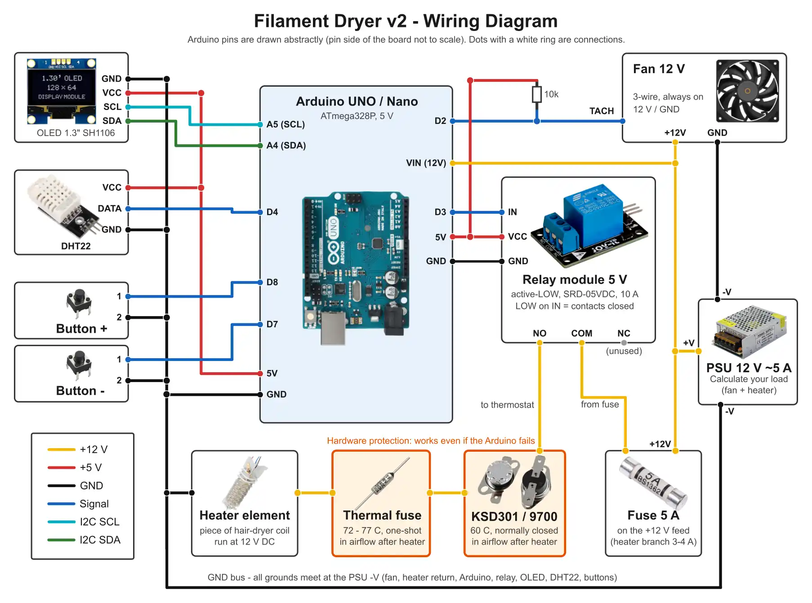

  <b>🇺🇸 English</b> · <a href="./README_ar.md">🇸🇦 العربية</a>

# 3D Printer Filament Dryer (v2)

🎥 **Build video:** [TikTok](https://www.tiktok.com/@fahad_alduraibi/video/7708110782969498900) · [YouTube Shorts](https://youtube.com/shorts/dSvKblwJmvQ)

An Arduino-controlled filament dryer: it heats an enclosure to an adjustable
target temperature (30–50 °C), circulates the air with a fan, shows temperature,
humidity and target on an OLED, and shuts everything down safely if something
goes wrong.

- Control: simple on/off with ±1 °C hysteresis (no PID needed for this job)
- Target: 45 °C by default, adjustable 30–50 °C with two buttons, remembered after power-off
- Safety: sensor validation, over-temperature latch, fan-stall detection, no-temperature-rise
  detection, hardware watchdog, plus a **hardware thermal cutoff** that works even if the
  Arduino or its code fails

---

## 1. How it works

### Normal operation

Every 2.1 s (the DHT22 needs ≥ 2 s between reads) the controller:

1. Reads temperature and humidity and checks they are plausible.
2. Counts the fan tach pulses from the last window.
3. Decides heater on/off:
   - heater turns **ON** below `target − 1 °C`
   - heater turns **OFF** above `target + 1 °C`
   - in between it keeps its previous state (hysteresis)
4. Fan: wired **directly to +12 V and GND, always on** (the sketch only reads its tach), so
   the air keeps moving and the heater element always cools.

The tach must show at least 200 pulses per 2 s (about 60% of the ~340 measured on my fan; 
adjust `FAN_MIN_PULSES` for yours). Only then is the heater allowed on ("fan proof before heat").
The check runs every cycle, so a fan that stops later latches a fault.

### Changing the target temperature

| Step | Action |
|---|---|
| 1 | Hold **+ and −** together for **1.5 s** → screen shows `EDIT` |
| 2 | Release both, then press **+** or **−** (1 °C per press, hold to repeat) |
| 3 | Stop pressing. After **3 s** the value is saved and used (`SAVED` is shown) |

- Range is clamped to **30–50 °C**.
- The heater keeps using the *old* target until the new one is saved.
- The value is stored in EEPROM (with a magic byte and inverted check byte); if the stored
  data is missing or corrupt it falls back to **45 °C**. It is only written when it actually
  changed, to save EEPROM wear.
- Requiring both buttons held for 1.5 s prevents accidental changes.

### Safety features (software)

Any of these **latches a fault**: heater off, reason shown on the OLED, cleared only by **power-cycling**.

| Fault | Trigger |
|---|---|
| Sensor failed | 5 invalid readings in a row (NaN, outside −10…80 °C, humidity outside 0–100 %, or a jump of > 8 °C between reads). The heater is turned off at the *first* bad reading; a single glitch recovers by itself |
| Over temperature | Reading ≥ **55 °C** |
| Fan stalled | Tach gives < 200 (or > 700 = noise) pulses/2 s on two consecutive checks (heater is cut on the first) |
| No temperature rise | Heater on continuously for **5 min** and the temperature rose < 0.5 °C. Catches a sensor stuck at a low value, a dead heater, or a very cold/open enclosure |

Other protections:

- The heater pin is driven OFF **before** it is made an output, so no power-up glitch.
- A single function (`heaterOn()`) is the only way to switch the heater on and it refuses
  if there is any fault, bad sensor, or unproven fan.
- An 8 s hardware **watchdog** resets the board if the code hangs (set `USE_WATCHDOG 0`
  for old Nano bootloaders that boot-loop with a watchdog).

### Hardware cutoff for protection (if software hangs)

Software cannot protect against a MOSFET/relay that welds or shorts closed, an Arduino
that crashes with the heater pin latched on, or a wiring fault. The **thermal cutoff**
(section 4) is wired in series with the heater and opens by itself at a fixed temperature
with no electronics involved. **Do not run the dryer without one.**

---

## 2. Components

### Core electronics

| # | Part | Used / assumed | Cheap, widely available alternatives |
|---|---|---|---|
| 1 | Microcontroller | Arduino Nano or Uno (ATmega328P) | Any ATmega328P board / clone. |
| 2 | Display | 1.3" 128×64 I2C OLED, **SH1106** (library: GyverOLED) | 0.96" SSD1306 I2C OLED – change `SSH1106_128x64` to `SSD1306_128x64` in the sketch |
| 3 | Temp/humidity sensor | **DHT22 / AM2302** (library: DHT sensor library by Adafruit) | **AM2301**, or **SHT31 / SHT41 / BME280** (I2C, more accurate and robust – needs a small code change) |
| 4 | Fan | PC Fan 12 V, 3-wire (+12 V, GND, tach). **Wired directly to +12 V / GND** | 4-wire can also be used, and the PWM can be used to lower the speed when the heater is off |
| 5 | Heater switch | Active-low relay / SSR module or 5v mechanical  | See section 3 |
| 6 | Heater | Short piece of a hair-dryer heating element (a *mains* element, but run here from **12 V DC**) – see "About the heater and power budget" below | PTC ceramic heater 12 V (e.g. **MK-PTC 12 V 100 W**), or a 12 V nichrome / silicone heating pad |
| 7 | Buttons | 2 × momentary push buttons | Any tactile switches or panel push buttons |
| 8 | Power supply | 12 V +5 A adapter (my measured load: **≈ 4 A** with fan and heater on) | A **12 V 5–6 A** adapter is enough (≥ 125 % of the load) and cheaper, e.g. **Mean Well LRS-75-12** (12 V 6.3 A) |
| 9 | 5 V supply for Arduino | Arduino UNO own regulator from 12 V | **LM2596 / MP1584 buck module** (12 V → 5 V) – more reliable than the Nano's linear regulator |

### About the heater and power budget

- The element is a piece cut from a **mains** hair-dryer coil, powered here from **12 V DC**. The
  shorter the piece, the lower its resistance and the higher the power: `P = V² / R`. With the
  whole system drawing ≈ 4 A at 12 V (≈ 48 W), the heater is roughly 3.5 A (≈ 40 W) and the fan the rest.
- **Never connect this element to mains** once it has been cut and re-wired for 12 V, and keep it
  physically separated from any mains wiring.
- A bare nichrome element runs **far hotter than the air** (hundreds of °C). Mount it on a ceramic,
  mica standoff, away from plastic, wires and the filament spool, and keep the fan running
  across it.
- Check the current once with a multimeter (in series) while heating, and make sure the relay/MOSFET
  you use is rated well above it.

### Small parts

| Qty | Part | Purpose |
|---|---|---|
| 1 | 10 kΩ resistor | Pull-up on fan tach to **5 V** (or change `pinMode(FANSENSORPIN, INPUT)` to `INPUT_PULLUP`) |
| 1 | 100 µF electrolytic capacitor | Across the 5 V rail near the Arduino |
| 1 | **5 A** fuse + holder (blade or 5×20 mm) | On the +12 V feed. The fuse protects the wiring and heater if something is wrong with the adapter. Load is ≈ 4 A, so 5 A is the right size |
| – | Wire | Heater circuit carries ≈ 3–4 A: use ≥ 20 AWG (0.5 mm²), 18 AWG / 0.75 mm² preferred, silicone-insulated near the heater |

---

## 3. Heater switching options

The sketch drives the heater pin **LOW = ON, HIGH = OFF** (active low). That matches
most relay / SSR *modules* with an opto-isolated input. Pick one:

| Option | Part numbers | Notes |
|---|---|---|
| **Relay module, active-low** *(typical)* | 1-channel 5 V relay module with optocoupler (SRD-05VDC-SL-C based), 10 A | Cheapest. SRD-05VDC contacts are rated 10 A / 30 V DC, so 12 V at ≈ 4 A is well within limits. Clicks on every cycle – fine at ±1 °C hysteresis |
| **Solid-state relay** | **SSR-25DD / SSR-40DD** (DC control, **DC load**) | Silent. **Do not use the "DA" types** (SSR-25DA, Fotek SSR-40DA): they only switch AC and will not work with a 12 V DC heater. Use a heatsink above ~3 A. Cheap SSRs can fail *shorted* – another reason for the thermal cutoff |
| **Logic-level MOSFET** (low-voltage DC heater) | **IRLZ44N**, **IRLB8721**, or a ready board such as **XY-MOS / D4184** | A bare MOSFET is *active-high*. To keep the sketch unchanged, add a transistor stage to invert it, or swap the `HIGH`/`LOW` in `heaterOff()`/`heaterOn()` and in `setup()` |

Whatever you use, keep a pull-up (or the module's own input pull-up) so the heater is
OFF when the Arduino pin is floating.

---

## 4. Thermal cutoff (hardware over-temperature protection)

Wire **one or both** of these in series with the heater supply (the hot leg *after* the
relay/SSR is fine, and also protects against the relay welding shut).

| Type | Part numbers | Why |
|---|---|---|
| **Resettable bimetal thermostat** (recommended first line) | **KSD301** (10 A), **KSD302** (16 A, same style, about the same price) or **KSD9700** (10 A, smaller body) – normally closed, **60 °C** open (rated for 250 V AC; derate on DC – 12 V at ≈ 4 A is far inside the limit) | Opens at ~60 °C, closes again when cooled, so a nuisance trip just pauses heating. Cost ≈ US$1 |
| **Thermal fuse** (recommended last line) | **RY-72 / RY 10A 250V 72–77 °C** thermal cutoff, **Cantherm / Nikkai** equivalents, **TF 10A 250V 77 °C** | One-shot: permanently opens at its rating. Use as the fail-safe if the thermostat itself fails. Cost ≈ US$0.30 |
| **Manual-reset thermostat** (optional) | **KSD301 manual-reset** variant, 70 °C | Stays open until you press the reset – a trip needs your attention |

**Suggested temperatures** (printer filament softens: PLA ~55 °C, so stay below it):

- Software hard limit: **55 °C** (already in the sketch)
- Thermostat (KSD301): **60 °C**
- Thermal fuse: **72–77 °C**

Mounting:

- Fit the thermostat and fuse **in the hot air stream just after the heater** (inside the
  chamber, a few cm downstream), where they sense the air heated by the element. KSD301/302/9700
  have ±5 °C tolerance and a metal face that must be exposed to or clamped on a metal part at
  that air temperature.
- **Do not touch them to the bare element** (it is far hotter than 60 °C even in normal
  operation and would trip them constantly). If the fan stalls, the air near the element
  heats up within seconds, so a device in the stream still opens quickly.
- Insulate the leads (silicone sleeve). Mains terminals must be fully enclosed.
- A fuse that is not actually near the heat source will not protect you.

---

## 5. Wiring

### Pin map

| Arduino pin | Connects to | Notes |
|---|---|---|
| **D2** | Fan tach wire | External interrupt. 10 kΩ pull-up to 5 V |
| **D3** | Heater switch input (IN) | **Active low**: LOW = heater ON. Pull-up to 5 V on this line |
| **D4** | DHT22 data | 10 kΩ pull-up to 5 V (unless the module has it) |
| **D7** | **−** button | Other side to GND (internal pull-up used) |
| **D8** | **+** button | Other side to GND (internal pull-up used) |
| **A4 (SDA)** | OLED SDA | I2C |
| **A5 (SCL)** | OLED SCL | I2C |
| **5 V / GND** | OLED VCC/GND, DHT22 VCC/GND, relay VCC/GND | Use 3.3 V for the OLED/DHT if your module requires it |

### Block diagram

### Wiring rules

1. **Common ground** between the 12 V supply, fan and Arduino.
2. The fan tach is open-collector: pull it up to **5 V**, never 12 V, or you may damage the Arduino.
3. Keep heater wiring short, thick and away from the DHT22 data line.
4. Mount the DHT22 in the air path, **away from the heater**, so it measures chamber air,
   not radiant heat from the element.
5. The fan is wired **straight to +12 V and GND (always on)**. If you have 4-wire fan with PWM then
   you can control its speed (I tried using PWN with my 3-wire fan but it impacted the tach readings).
6. The heater circuit is **12 V DC** (a piece of hair-dryer element). Keep it fully separated from any
   mains wiring, fuse it (5 A), and never plug the cut element into mains.

---

## 6. Software setup

1. Install in Arduino IDE → Library Manager:
   - **GyverOLED**
   - **DHT sensor library** (Adafruit) and **Adafruit Unified Sensor**
2. Board: **Arduino Uno**.
3. Open the code and upload.
4. Open the Serial Monitor at **9600 baud** for live status, e.g.
   `Heating... Temp = 38.20  Target = 45.00  Fan pulses/2s = 112`.

### Tunable settings (top of the sketch)

| Constant | Default | Meaning |
|---|---|---|
| `DEFAULT_TARGET` | 45 | Target on first boot / invalid EEPROM |
| `TARGET_MIN` / `TARGET_MAX` | 30 / 50 | Allowed target range |
| `tempTolerance` | 1.0 | Hysteresis band (± °C) |
| `HARD_MAX_TEMP` | 55 | Over-temperature latch |
| `FAN_MIN_PULSES` | 200 | Minimum tach pulses per 2 s. **Check the serial output once** with your fan and set this to roughly half of the normal value |
| `FAN_MAX_PULSES` | 700 | Upper limit. A count *above* this is treated as tach noise (e.g. missing pull-up), not as a healthy fan, so a blocked fan cannot pass the check by "producing" noise pulses |
| `HEAT_CHECK_MS` / `HEAT_MIN_RISE` | 5 min / 0.5 °C | No-temperature-rise check. Raise the time or lower the rise if it trips in a cold room |
| `USE_WATCHDOG` | 1 | Hardware watchdog 1=on, 0=off |

---

## 7. Fault screens

| Screen | Meaning | What to check |
|---|---|---|
| `FAULT! Temp sensor failed` | DHT22 unreadable or implausible | Wiring, pull-up, sensor |
| `FAULT! Over temperature` | ≥ 55 °C | Heater switch stuck on? Sensor placement? |
| `FAULT! Fan stalled` | Tach pulses too low | Fan blocked/unplugged, tach wiring, `FAN_MIN_PULSES` |
| `FAULT! No temp rise` | Heater on 5 min, no warming | Sensor reading stuck, heater/relay dead, thermostat tripped, lid open |
| `Failed to read from DHT sensor! Heater paused` | Temporary read error | Clears itself on the next good reading |

A latched fault stays until you power-cycle the dryer.

**Note on the fan tach:** the fan runs on a plain 12 V supply, so the tach is clean and every
2 s window is checked. Measured on my fan: ~340 pulses/2 s when healthy, falling steadily as the
fan is slowed, 0 when stalled. Do not add PWM or a transistor on the fan's ground: the tach then
reads erratic values that can look like a healthy fan, and if you do it then test the reading and make
sure it is correct.

---

## 8. Testing checklist (before leaving it unattended)

- [ ] Boots with the heater **off** (no relay click on power-up)
- [ ] Fan tach shows plausible pulses/2 s in the Serial Monitor; `FAN_MIN_PULSES` set accordingly
- [ ] Unplug the DHT22 → heater turns off, `Failed to read…`, then `FAULT` after ~10 s
- [ ] Block/unplug the fan tach → heater stops, `Fan stalled` fault
- [ ] Both-button hold enters EDIT mode; value limits at 30 and 50; value survives a power cycle
- [ ] Thermostat/thermal fuse physically tested (e.g. with a heat gun) to confirm it opens the heater circuit
- [ ] First long run done while you are present, checking with a separate thermometer that the display matches the real chamber temperature

---

## 9. Safety notes

- Never leave a heater running unattended until you have verified every item in section 8.
- Don't cover the vents or run with the fan disconnected.
- Keep the target at or below the lowest softening point of the filament you dry
  (PLA ≈ 45 °C, PETG ≈ 65 °C, ABS/ASA ≈ 80 °C; this build is limited to 50 °C).
- Use flame-retardant or metal enclosure parts near the heater, and keep the bare element away from plastic.

## 10. Disclaimer

**Build and use this project entirely at your own risk.**

This project involves a heating element, a high-current 12 V DC supply, and possibly mains
voltage wiring, all of which can cause electric shock, burns, fire, property damage, injury or
death if designed, built, wired, tested or used incorrectly. The information, schematics,
diagrams, part suggestions and source code in this repository are provided for educational and
informational purposes only, **"AS IS" and without warranty of any kind**, express or implied,
including but not limited to warranties of merchantability, fitness for a particular purpose,
safety, accuracy, completeness or non-infringement. The safety features described here
reduce risk but do not eliminate it, and they have not been certified or tested to any
safety standard (such as UL, CE or IEC).

To the fullest extent permitted by applicable law, the author and contributors **shall not be
held liable** for any direct, indirect, incidental, special, consequential or other damages,
losses, injuries, or claims of any kind (including damage to equipment, filament, 3D printers,
property, or harm to persons or animals) arising out of or in connection with the use of, or
inability to use, this project or any part of its content, even if advised of the possibility of
such damage.

By building or using anything based on this project you accept full responsibility for
your own safety and for compliance with the laws and regulations that apply to you. You are
responsible for verifying every part, rating and wiring detail yourself, for consulting a
qualified person if you are unsure, and for **never leaving the device running unattended**
unless you are satisfied that it is safe to do so. If you are not experienced with electronics
and heating devices, do not build this.

