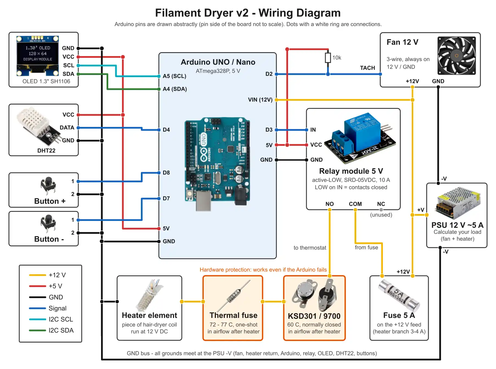

# مجفف خيوط الطابعة ثلاثية الأبعاد (الإصدار 2)

🎥 **فيديو البناء:** [TikTok](https://www.tiktok.com/@fahad_alduraibi/video/7708110782969498900) · [YouTube Shorts](https://youtube.com/shorts/dSvKblwJmvQ)

مجفف خيوط يعمل بالأردوينو: يسخّن الصندوق إلى درجة حرارة مستهدفة قابلة للتعديل (30–50 °م)، ويحرّك الهواء بمروحة، ويعرض الحرارة والرطوبة والقيمة المستهدفة على شاشة OLED، ويُطفئ كل شيء بأمان عند حدوث أي عطل.

- التحكم: تشغيل/إيقاف بسيط مع فرق تباطؤ ±1 °م (لا حاجة لـ PID في هذا المشروع)
- الهدف: 45 °م افتراضياً، قابل للتعديل من 30 إلى 50 °م بزرّين، ويُحفظ بعد إطفاء الجهاز
- الأمان: فحص صحة المستشعر، قفل عند الحرارة الزائدة، كشف توقف المروحة، كشف عدم ارتفاع الحرارة، مؤقت حارس (Watchdog)، بالإضافة إلى **قاطع حراري هاردويري** يعمل حتى لو تعطل الأردوينو أو الكود

---

## 1. طريقة العمل

### التشغيل العادي

كل 2.1 ثانية (مستشعر DHT22 يحتاج ≥ 2 ثانية بين القراءتين) يقوم المتحكم بـ:

1. قراءة الحرارة والرطوبة والتأكد من أنها منطقية.
2. عدّ نبضات حساس سرعة المروحة (Tach) للفترة الماضية.
3. تحديد تشغيل/إيقاف السخان:
   - يعمل السخان عندما تكون الحرارة **أقل من** `الهدف − 1 °م`
   - يتوقف السخان عندما تكون الحرارة **أعلى من** `الهدف + 1 °م`
   - بين الحدّين يبقى على حالته السابقة (فرق التباطؤ)
4. المروحة: موصولة **مباشرة بـ +12 فولت وGND وتعمل دائماً** (الكود يقرأ حساس السرعة Tach فقط)، فيبقى الهواء متحركاً ويبرد عنصر التسخين دائماً.

يجب أن يُظهر حساس السرعة 200 نبضة على الأقل كل ثانيتين (نحو 60% من الـ ~340 المقاسة على مروحة المؤلف؛ عدّل `FAN_MIN_PULSES` لمروحتك). عندها فقط يُسمح بتشغيل السخان ("إثبات المروحة قبل التسخين"). يتكرر الفحص في كل دورة، فإذا توقفت المروحة لاحقاً يُقفل عطل.

### تغيير درجة الحرارة المستهدفة

| الخطوة | الإجراء |
|---|---|
| 1 | اضغط مع الاستمرار على **+ و −** معاً لمدة **1.5 ثانية** ← تظهر كلمة `EDIT` على الشاشة |
| 2 | اترك الزرّين، ثم اضغط **+** أو **−** (1 °م لكل ضغطة، والضغط المستمر يكرر) |
| 3 | توقف عن الضغط. بعد **3 ثوانٍ** تُحفظ القيمة وتُستخدم (تظهر كلمة `SAVED`) |

- المدى محصور بين **30 و 50 °م**.
- يستمر السخان باستخدام القيمة *القديمة* حتى تُحفظ القيمة الجديدة.
- تُخزَّن القيمة في EEPROM (مع بايت تعريف وبايت تحقق معكوس)؛ وإذا كانت البيانات مفقودة أو تالفة تعود القيمة إلى **45 °م**. لا تُكتب القيمة إلا إذا تغيّرت فعلاً، للحفاظ على عمر الذاكرة.
- اشتراط الضغط على الزرّين معاً لمدة 1.5 ثانية يمنع التغيير بالخطأ.

### ميزات الأمان (البرمجية)

أي من الحالات التالية **تُفعّل عطلاً مقفلاً**: السخان يُطفأ، يظهر السبب على الشاشة، ولا يُمسح العطل إلا **بإعادة تشغيل الجهاز (فصل وتوصيل الكهرباء)**.

| العطل | شرط حدوثه |
|---|---|
| فشل المستشعر | 5 قراءات غير صالحة متتالية (NaN، أو خارج المدى −10…80 °م، أو رطوبة خارج 0–100%، أو قفزة أكبر من 8 °م بين قراءتين). يُطفأ السخان عند **أول** قراءة سيئة؛ والخلل العابر لمرة واحدة يزول من تلقاء نفسه |
| حرارة زائدة | قراءة ≥ **55 °م** |
| توقف المروحة | حساس Tach يعطي أقل من 200 (أو أكثر من 700 = ضجيج) نبضة/2 ثانية في فحصين متتاليين (يُقطع السخان عند الأول) |
| لا ارتفاع في الحرارة | السخان يعمل باستمرار **5 دقائق** وارتفعت الحرارة أقل من 0.5 °م. يكشف مستشعراً عالقاً على قيمة منخفضة، أو سخاناً معطلاً، أو صندوقاً مفتوحاً/بارداً جداً |

حمايات أخرى:

- يُدفع طرف السخان إلى حالة الإطفاء **قبل** جعله خرجاً، فلا يحدث تشغيل عابر عند بدء التشغيل.
- دالة واحدة فقط (`heaterOn()`) تستطيع تشغيل السخان، وترفض ذلك عند وجود أي عطل أو مستشعر سيئ أو مروحة غير مثبتة.
- **مؤقت حارس** (Watchdog) بمدة 8 ثوانٍ يعيد تشغيل البوردة إذا علق الكود (اجعل `USE_WATCHDOG 0` مع محمّل الإقلاع القديم للـ Nano الذي يدخل في حلقة إعادة تشغيل مع الـ Watchdog).

### القاطع الهاردويري للحماية (إذا علق البرنامج)

لا يستطيع البرنامج الحماية من ريليه/ترانزستور يلتصق أو يحدث له قصر في وضع التشغيل، أو من أردوينو يتعطل وطرف السخان عالق على التشغيل، أو من خطأ في التوصيل. **القاطع الحراري** (القسم 4) موصول على التوالي مع السخان ويفتح من تلقاء نفسه عند درجة حرارة ثابتة دون أي إلكترونيات. **لا تشغّل المجفف بدونه.**

---

## 2. المكونات

### الإلكترونيات الأساسية

| # | القطعة | المستخدم / المفترض | بدائل رخيصة ومتوفرة |
|---|---|---|---|
| 1 | المتحكم | Arduino Nano أو Uno (ATmega328P) | أي بوردة ATmega328P أو نسخة مطابقة |
| 2 | الشاشة | OLED مقاس 1.3" بدقة 128×64 وبروتوكول I2C، شريحة **SH1106** (المكتبة: GyverOLED) | شاشة OLED مقاس 0.96" بشريحة SSD1306 – غيّر `SSH1106_128x64` إلى `SSD1306_128x64` في الكود |
| 3 | مستشعر الحرارة والرطوبة | **DHT22 / AM2302** (المكتبة: DHT sensor library من Adafruit) | **AM2301**، أو **SHT31 / SHT41 / BME280** (I2C، أدق وأكثر متانة – تحتاج تعديلاً بسيطاً في الكود) |
| 4 | المروحة | مروحة كمبيوتر 12 فولت بثلاثة أسلاك (+12 فولت، GND، Tach). **موصولة مباشرة بـ +12 فولت / GND** | يمكن استخدام مروحة بأربعة أسلاك أيضاً، ويمكن استخدام PWM لخفض سرعتها عندما يكون السخان مطفأً |
| 5 | مفتاح السخان | موديول ريليه/SSR يعمل بإشارة منخفضة (Active-low) أو ريليه ميكانيكي 5 فولت | انظر القسم 3 |
| 6 | السخان | قطعة قصيرة من عنصر تسخين مجفف شعر (عنصر لجهد *الشبكة* لكنه يعمل هنا على **12 فولت DC**) – انظر "عن السخان وميزانية الطاقة" أدناه | سخان PTC سيراميك 12 فولت (مثل **MK-PTC 12 V 100 W**)، أو سخان نيكروم/سيليكون 12 فولت |
| 7 | الأزرار | زرّان لحظيان | أي أزرار Tactile 6×6 مم أو أزرار لوحة |
| 8 | مزود الطاقة | محول 12 فولت +5 أمبير (الحمل المقاس: **≈ 4 أمبير** مع تشغيل المروحة والسخان) | محول **12 فولت 5–6 أمبير** يكفي (≥ 125% من الحمل) وأرخص، مثل **Mean Well LRS-75-12** (12 فولت 6.3 أمبير) |
| 9 | مصدر 5 فولت للأردوينو | منظم الجهد الداخلي في Arduino UNO من 12 فولت | موديول خافض **LM2596 / MP1584** (12 ← 5 فولت) – أكثر اعتمادية من المنظم الخطي في الـ Nano |

### عن السخان وميزانية الطاقة

- العنصر قطعة مقصوصة من ملف تسخين مجفف شعر يعمل على **جهد الشبكة**، وهو هنا يُغذّى بـ **12 فولت DC**. كلما قصرت القطعة قلّت مقاومتها وزادت القدرة: `P = V² / R`. النظام كله يسحب ≈ 4 أمبير عند 12 فولت (≈ 48 واط)، أي أن السخان نحو 3.5 أمبير (≈ 40 واط) والمروحة الباقي.
- **لا توصّل هذا العنصر بجهد الشبكة أبداً** بعد قصّه وإعادة توصيله لـ 12 فولت، وأبقِه بعيداً فيزيائياً عن أي أسلاك شبكة.
- عنصر النيكروم العاري يعمل في حرارة **أعلى بكثير من حرارة الهواء** (مئات الدرجات). ركّبه على قاعدة سيراميك أو ميكا أو معدن، بعيداً عن البلاستيك والأسلاك وبكرة الخيط، وأبقِ المروحة تهبّ عليه.
- قِس التيار مرة بالأفوميتر (على التوالي) أثناء التسخين، وتأكد أن الريليه/MOSFET المستخدم مقنَّن بأعلى منه بكثير.

### القطع الصغيرة

| العدد | القطعة | الغرض |
|---|---|---|
| 1 | مقاومة 10 كيلو أوم | Pull-up لخط Tach المروحة إلى **5 فولت** (أو غيّر `pinMode(FANSENSORPIN, INPUT)` إلى `INPUT_PULLUP`) |
| 1 | مكثف إلكتروليتي 100 µF | على خط 5 فولت قرب الأردوينو |
| 1 | فيوز **5 أمبير** + حامل (شريحة أو 5×20 مم) | على خط +12 فولت. يحمي الفيوز الأسلاك والسخان إذا حدث خلل في المحول. الحمل ≈ 4 أمبير فالـ 5 أمبير هو المقاس المناسب |
| – | أسلاك | دائرة السخان تحمل ≈ 3–4 أمبير: استخدم ≥ 20 AWG (0.5 مم²)، ويفضل 18 AWG / 0.75 مم²، بعزل سيليكوني قرب السخان |

---

## 3. خيارات تبديل السخان

يقود الكود طرف السخان بحيث **LOW = تشغيل، HIGH = إيقاف** (Active-low). وهذا يناسب أغلب موديولات الريليه/SSR ذات المدخل المعزول بالـ Optocoupler. اختر أحد الخيارات:

| الخيار | أرقام القطع | ملاحظات |
|---|---|---|
| **موديول ريليه، Active-low** *(الأكثر شيوعاً)* | موديول ريليه 5 فولت قناة واحدة مع optocoupler (مبني على SRD-05VDC-SL-C)، 10 أمبير | الأرخص. ملامسات SRD-05VDC مقنَّنة 10 أمبير / 30 فولت DC، فـ 12 فولت عند ≈ 4 أمبير ضمن الحدود بكثير. يُصدر نقرة عند كل تبديل – لا بأس بذلك مع فرق تباطؤ ±1 °م |
| **ريليه الحالة الصلبة (SSR)** | **SSR-25DD / SSR-40DD** (تحكم DC، **حمل DC**) | صامت. **لا تستخدم نوع "DA"** (SSR-25DA وFotek SSR-40DA): فهو يقطع تيار AC فقط ولن يعمل مع سخان 12 فولت DC. استخدم مشتت حرارة فوق 3 أمبير تقريباً. قد تتعطل الـ SSR الرخيصة وهي في وضع *القصر* – سبب إضافي للقاطع الحراري |
| **MOSFET منطقي المستوى** (سخان جهد منخفض DC) | **IRLZ44N**، **IRLB8721**، أو لوحة جاهزة مثل **XY-MOS / D4184** | الـ MOSFET المنفرد *Active-high*. للإبقاء على الكود دون تغيير أضف مرحلة ترانزستور تعكس الإشارة، أو بدّل `HIGH`/`LOW` في `heaterOff()`/`heaterOn()` وفي `setup()` |

أياً كان الخيار، احتفظ بمقاومة Pull-up (أو Pull-up المدخل المدمج في الموديول) لكي يبقى السخان مطفأً عندما يكون طرف الأردوينو عائماً.

---

## 4. القاطع الحراري (حماية هاردويري من الحرارة الزائدة)

وصّل **أحد** هذين القاطعين أو **كليهما** على التوالي مع تغذية السخان (الجهة الساخنة بعد الريليه/SSR مناسبة، وتحمي أيضاً من التصاق الريليه).

| النوع | أرقام القطع | السبب |
|---|---|---|
| **ثرموستات ثنائي المعدن قابل لإعادة الضبط** (خط الدفاع الأول الموصى به) | **KSD301** (10 أمبير)، **KSD302** (16 أمبير، نفس الشكل وبنفس السعر تقريباً) أو **KSD9700** (10 أمبير، بجسم أصغر) – عادةً مغلق (NC)، يفتح عند **60 °م** (مقنَّن لـ 250 فولت AC؛ خفّض القيمة مع DC – 12 فولت عند ≈ 4 أمبير ضمن الحدود بكثير) | يفتح عند ~60 °م ويُغلق عند البرودة، فيكون الفصل الخاطئ مجرد توقف مؤقت. التكلفة ≈ دولار واحد |
| **فيوز حراري** (خط الدفاع الأخير الموصى به) | **RY-72 / RY 10A 250V 72–77 °م** قاطع حراري، أو ما يعادله من **Cantherm / Nikkai**، أو **TF 10A 250V 77 °م** | مرة واحدة: يفتح نهائياً عند قيمته. استخدمه كخط أمان إذا تعطل الثرموستات نفسه. التكلفة ≈ 0.3 دولار |
| **ثرموستات بإعادة ضبط يدوية** (اختياري) | نسخة **KSD301 بإعادة ضبط يدوية**، 70 °م | يبقى مفتوحاً حتى تضغط زر الإعادة – أي أن الفصل يستدعي انتباهك |

**درجات الحرارة المقترحة** (تلين خيوط الطباعة: PLA عند ~55 °م لذا ابقَ دونها):

- الحد البرمجي الصارم: **55 °م** (موجود في الكود)
- الثرموستات (KSD301): **60 °م**
- الفيوز الحراري: **72–77 °م**

التركيب:

- ثبّت الثرموستات والفيوز **في مجرى الهواء الساخن بعد السخان مباشرة** (داخل الصندوق، على بعد بضعة سم)، حيث يستشعران الهواء المسخّن بالعنصر. القواطع KSD301/302/9700 بتفاوت ±5 °م، ووجهها المعدني يجب أن يتعرض لهذا الهواء أو يُثبَّت على قطعة معدنية بحرارته.
- **لا تلصقهما بالعنصر العاري** (فهو أسخن بكثير من 60 °م حتى في التشغيل الطبيعي وسيجعلهما يفصلان باستمرار). وإذا توقفت المروحة يسخن الهواء قرب العنصر خلال ثوانٍ، فيفتح القاطع الموجود في مجرى الهواء بسرعة.
- اعزل الأطراف (غلاف سيليكون). الأطراف الكهربائية العاملة بجهد الشبكة يجب أن تكون مغلقة تماماً.
- فيوز غير موضوع قرب مصدر الحرارة فعلاً لن يحميك.

---

## 5. التوصيل

### جدول الأطراف

| طرف الأردوينو | يتصل بـ | ملاحظات |
|---|---|---|
| **D2** | سلك Tach المروحة | مقاطعة خارجية. Pull-up 10 كيلو أوم إلى 5 فولت |
| **D3** | مدخل مفتاح السخان (IN) | **Active-low**: LOW = السخان يعمل. Pull-up إلى 5 فولت على هذا الخط |
| **D4** | بيانات DHT22 | Pull-up 10 كيلو أوم إلى 5 فولت (إلا إذا كان الموديول مزوداً به) |
| **D7** | زر **−** | الطرف الآخر إلى GND (يُستخدم Pull-up الداخلي) |
| **D8** | زر **+** | الطرف الآخر إلى GND (يُستخدم Pull-up الداخلي) |
| **A4 (SDA)** | SDA الخاص بشاشة OLED | I2C |
| **A5 (SCL)** | SCL الخاص بشاشة OLED | I2C |
| **5V / GND** | VCC/GND للـ OLED وDHT22 والريليه | استخدم 3.3 فولت للـ OLED/DHT إذا كان الموديول يتطلب ذلك |

### مخطط التوصيل

### قواعد التوصيل

1. **أرضي مشترك** بين مزود 12 فولت والمروحة والأردوينو.
2. خط Tach للمروحة من نوع Open-collector: ارفعه (Pull-up) إلى **5 فولت** وليس 12 فولت أبداً وإلا قد يتضرر الأردوينو.
3. اجعل أسلاك السخان قصيرة وسميكة وبعيدة عن خط بيانات DHT22.
4. ركّب DHT22 في مجرى الهواء و**بعيداً عن السخان** لكي يقيس هواء الصندوق لا الإشعاع الحراري من العنصر.
5. المروحة موصولة **مباشرة بـ +12 فولت وGND وتعمل دائماً**. إذا كانت لديك مروحة بأربعة أسلاك مع PWM فيمكنك التحكم بسرعتها (جرّبت PWM مع مروحتي ذات الأسلاك الثلاثة لكنه أثّر على قراءات Tach).
6. دائرة السخان **12 فولت DC** (قطعة من عنصر مجفف شعر). افصلها تماماً عن أي أسلاك شبكة، وضع لها فيوز (5 أمبير)، ولا توصّل العنصر المقصوص بجهد الشبكة أبداً.

---

## 6. إعداد البرنامج

1. ثبّت من Arduino IDE ← Library Manager:
   - **GyverOLED**
   - **DHT sensor library** (من Adafruit) و **Adafruit Unified Sensor**
2. البوردة: **Arduino Uno**.
3. افتح الكود وارفعه.
4. افتح Serial Monitor على **9600 baud** لمتابعة الحالة، مثل:
   `Heating... Temp = 38.20  Target = 45.00  Fan pulses/2s = 112`.

### الإعدادات القابلة للتعديل (أعلى الكود)

| الثابت | القيمة الافتراضية | المعنى |
|---|---|---|
| `DEFAULT_TARGET` | 45 | الهدف عند أول تشغيل / EEPROM غير صالحة |
| `TARGET_MIN` / `TARGET_MAX` | 30 / 50 | المدى المسموح للهدف |
| `tempTolerance` | 1.0 | نطاق فرق التباطؤ (± °م) |
| `HARD_MAX_TEMP` | 55 | حد القفل للحرارة الزائدة |
| `FAN_MIN_PULSES` | 200 | أدنى عدد نبضات Tach كل ثانيتين. **افحص خرج Serial مرة واحدة** مع مروحتك واضبطه على نحو نصف القيمة الطبيعية |
| `FAN_MAX_PULSES` | 700 | الحد الأعلى. أي عدد *أعلى* منه يُعتبر ضجيجاً على خط Tach (مثلاً بسبب غياب Pull-up) وليس مروحة سليمة، فلا تستطيع مروحة معاقة اجتياز الفحص بنبضات ضجيج |
| `HEAT_CHECK_MS` / `HEAT_MIN_RISE` | 5 دقائق / 0.5 °م | فحص عدم ارتفاع الحرارة. ارفع المدة أو اخفض الارتفاع المطلوب إذا حدث فصل في غرفة باردة |
| `USE_WATCHDOG` | 1 | تفعيل/تعطيل مؤقت الحارس |

---

## 7. شاشات الأعطال

| الشاشة | المعنى | ما يجب فحصه |
|---|---|---|
| `FAULT! Temp sensor failed` | DHT22 لا يقرأ أو قراءاته غير منطقية | التوصيل، Pull-up، المستشعر |
| `FAULT! Over temperature` | ≥ 55 °م | هل مفتاح السخان عالق على التشغيل؟ موضع المستشعر؟ |
| `FAULT! Fan stalled` | نبضات Tach قليلة جداً | المروحة معاقة/مفصولة، توصيل Tach، `FAN_MIN_PULSES` |
| `FAULT! No temp rise` | السخان يعمل 5 دقائق دون ارتفاع | قراءة المستشعر عالقة، السخان/الريليه معطل، الثرموستات فصل، الغطاء مفتوح |
| `Failed to read from DHT sensor! Heater paused` | خطأ قراءة مؤقت | يزول تلقائياً عند أول قراءة سليمة |

يبقى العطل المقفل حتى تعيد تشغيل المجفف (فصل الكهرباء ثم توصيلها).

**ملاحظة عن حساس سرعة المروحة (Tach):** المروحة تعمل على 12 فولت عادية، فإشارة Tach نظيفة ويُفحص كل نافذة بمدة ثانيتين. المقاس على مروحة المؤلف: ~340 نبضة/2 ثانية وهي سليمة، تنخفض تدريجياً مع إبطائها، و0 عند توقفها. لا تضف PWM أو ترانزستوراً ثنائي القطب على أرضي المروحة: فتصبح قراءات Tach عشوائية وقد تبدو كمروحة سليمة، وإذا فعلت ذلك فاختبر القراءة وتأكد من صحتها.

---

## 8. قائمة الاختبار (قبل تركه دون مراقبة)

- [ ] يقلع والسخان **مطفأ** (لا نقرة ريليه عند التشغيل)
- [ ] حساس Tach يُظهر نبضات/2 ثانية منطقية في Serial Monitor؛ وضبط `FAN_MIN_PULSES` وفقاً لذلك
- [ ] افصل DHT22 ← يُطفأ السخان، تظهر `Failed to read…`، ثم `FAULT` بعد ~10 ثوانٍ
- [ ] أعق المروحة أو افصل Tach ← يتوقف السخان ويظهر عطل `Fan stalled`
- [ ] الضغط على الزرّين معاً يدخل وضع EDIT؛ الحدّان 30 و 50؛ والقيمة تبقى بعد إعادة التشغيل
- [ ] اختبار الثرموستات/الفيوز الحراري فعلياً (مثلاً بمسدس حراري) للتأكد من أنه يفتح دائرة السخان
- [ ] أول تشغيل طويل بحضورك، مع التحقق بميزان حرارة منفصل أن الشاشة تطابق حرارة الصندوق الفعلية

---

## 9. ملاحظات السلامة

- لا تترك السخان يعمل دون مراقبة حتى تتحقق من كل بند في القسم 8.
- لا تغطِّ فتحات التهوية ولا تشغّل الجهاز والمروحة مفصولة.
- أبقِ الهدف عند أو دون أدنى درجة ليونة للخيط الذي تجففه (PLA ≈ 45 °م، PETG ≈ 65 °م، ABS/ASA ≈ 80 °م؛ هذا التصميم محدود بـ 50 °م).
- استخدم مواد صندوق مقاومة للهب أو معدنية قرب السخان، وأبعد العنصر العاري عن البلاستيك.

## 10. إخلاء المسؤولية

**ابنِ هذا المشروع واستخدمه على مسؤوليتك الخاصة بالكامل.**

يتضمن هذا المشروع عنصر تسخين ومصدر طاقة 12 فولت DC عالي التيار، وربما أسلاكاً بجهد الشبكة، وكلها قد تتسبب بصعقة كهربائية أو حروق أو حريق أو أضرار في الممتلكات أو إصابات أو وفاة إذا صُمّمت أو بُنيت أو وُصّلت أو اختُبرت أو استُخدمت بشكل غير صحيح. المعلومات والمخططات والرسومات واقتراحات القطع والكود المصدري في هذا المستودع مقدَّمة لأغراض تعليمية وإعلامية فقط، **"كما هي" ودون أي ضمان من أي نوع**، صريحاً كان أو ضمنياً، بما في ذلك على سبيل المثال لا الحصر ضمانات الجودة التجارية أو الملاءمة لغرض معيّن أو السلامة أو الدقة أو الاكتمال أو عدم الانتهاك. ميزات الأمان المذكورة هنا تقلل المخاطر لكنها لا تلغيها، ولم يتم اعتمادها أو اختبارها وفق أي معيار سلامة (مثل UL أو CE أو IEC).

إلى أقصى حد يسمح به القانون المعمول به، **لا يتحمل المؤلف والمساهمون أي مسؤولية** عن أي أضرار أو خسائر أو إصابات أو مطالبات مباشرة أو غير مباشرة أو عرضية أو خاصة أو تبعية من أي نوع (بما في ذلك تلف المعدات أو الخيوط أو الطابعات ثلاثية الأبعاد أو الممتلكات، أو الأذى للأشخاص أو الحيوانات) ناشئة عن استخدام هذا المشروع أو أي جزء من محتواه أو عدم القدرة على استخدامه أو متصلة بذلك، حتى لو أُبلغوا باحتمال حدوث هذه الأضرار.

ببنائك أو استخدامك لأي شيء مبني على هذا المشروع فإنك تتحمل المسؤولية الكاملة عن سلامتك وعن الامتثال للقوانين واللوائح السارية عليك. أنت المسؤول عن التحقق بنفسك من كل قطعة وكل تقنين وكل تفصيل في التوصيل، وعن استشارة شخص مؤهل إذا لم تكن متأكداً، وعن **عدم ترك الجهاز يعمل دون مراقبة** ما لم تكن مقتنعاً بأنه آمن. وإذا لم تكن لديك خبرة في الإلكترونيات وأجهزة التسخين فلا تبنِ هذا المشروع.

